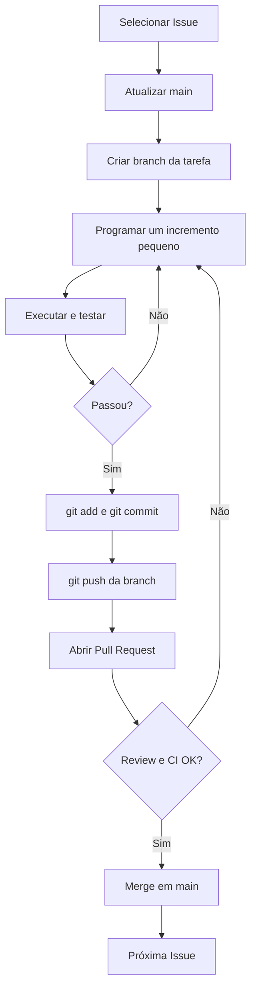
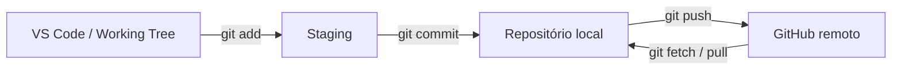
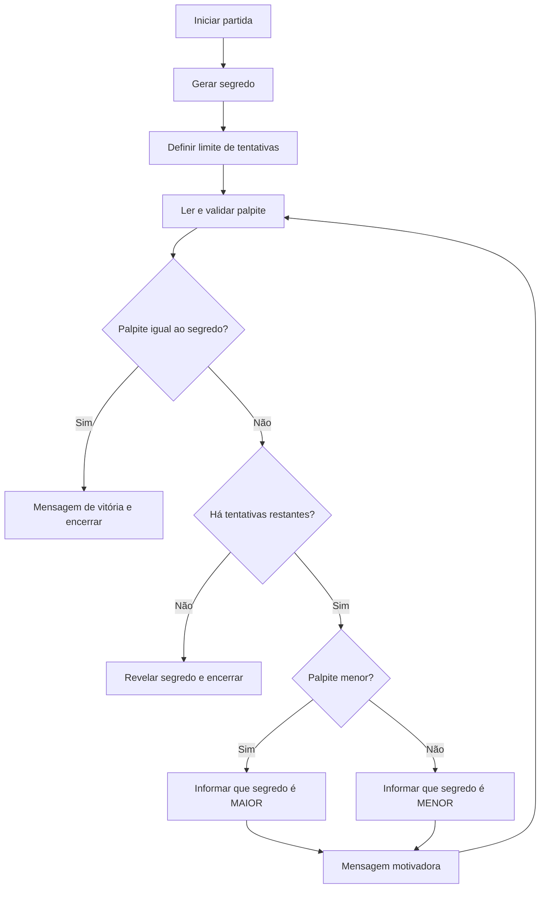

# 🧭 Projeto final + Git/GitHub — Memento para Obsidian

> [!abstract] Meta
> Aprender a entregar o jogo **Descubra o Número Secreto** como se fosse um pequeno projeto de equipe: cada função é uma entrega versionada com Issue, branch, commit, teste e Pull Request.

## 🔁 Ciclo de desenvolvimento



## 🧠 Onde o código vive?



## 🧩 Requisitos do jogo



> [!important] O fluxo desenha o comportamento desejado, não uma implementação já existente. Use-o para orientar sua própria construção.

## 📌 Todo o curso em pequenas entregas

- [ ] Fase 0: criar repositório e publicar o commit inicial.
- [ ] Fase 1: gerar o segredo com modo de teste.
- [ ] Fase 2: validar a digitação.
- [ ] Fase 3: implementar loop, dicas, vitória e derrota.
- [ ] Fase 4: incluir mensagens motivadoras.
- [ ] Fase 5: automatizar testes comportamentais.
- [ ] Fase 6: publicar o MVP `v1.0.0`.
- [ ] Extra: escolher intervalo.
- [ ] Extra: dificuldades.
- [ ] Extra: histórico de tentativas.
- [ ] Extra: opção de replay.

## ⚙️ Comandos de bolso

```powershell
git status
git switch main
git pull --ff-only origin main
git switch -c feat/numero-secreto
git add numero_secreto.py
git commit -m "feat(game): adiciona geracao de numero secreto"
git push -u origin feat/numero-secreto
```

## 🧠 Flashcards

O que é um commit?::Registro local versionado de alterações no repositório Git.

O que faz `git add`?::Seleciona mudanças para o próximo commit (staging).

Um `git commit` publica automaticamente no GitHub?::Não; para enviar ao remoto normalmente é necessário `git push`.

Por que fazer uma branch para cada funcionalidade?::Isola o trabalho da linha estável `main` e facilita revisão/integração.

O que significa `feat:`?::Novo recurso implementado.

O que significa `fix:`?::Correção de um problema no código.

O que é Pull Request?::Proposta de integrar as mudanças de uma branch a outra, permitindo revisão e checks.

O que a CI testa no primeiro commit deste repositório?::Somente sintaxe e teste inicial da estrutura, não as regras completas do jogo.

O que o `random.randint(1, 100)` inclui?::Os extremos 1 e 100.

Qual a primeira tarefa da fase 1?::Implementar `gerar_numero_secreto()` usando modo fixo e sorteio aleatório.

## 🧪 Autoavaliação

> [!question]- Quando usar `feat`, `test` e `docs`?
> `feat`: implementação funcional; `test`: testes; `docs`: documentação.

> [!question]- Qual o risco de fazer todo o jogo antes do primeiro push?
> Perder a trilha didática de mudanças pequenas, dificultar revisão e misturar responsabilidades em um commit grande.

> [!question]- Como verificar o que você adicionou ao próximo commit?
> `git diff --cached`.

> [!question]- Qual regra do PDF justifica usar `numero_fixo=42`?
> Facilitar testes determinísticos das dicas, vitória e derrota.

## 📎 Leitura complementar

- [[COMANDOS_GIT]]
- [[ETAPAS]]
- [[PASSO_01]]